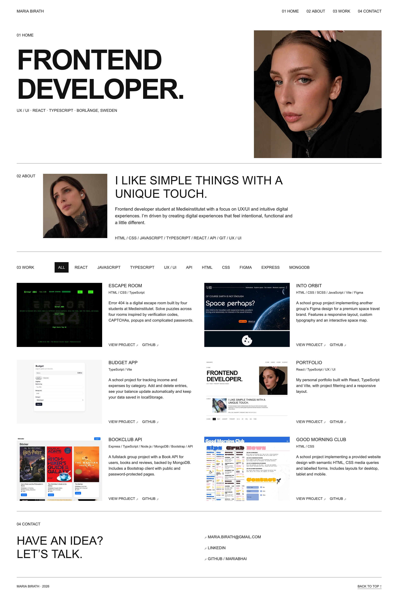
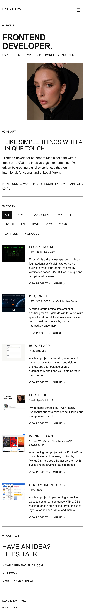
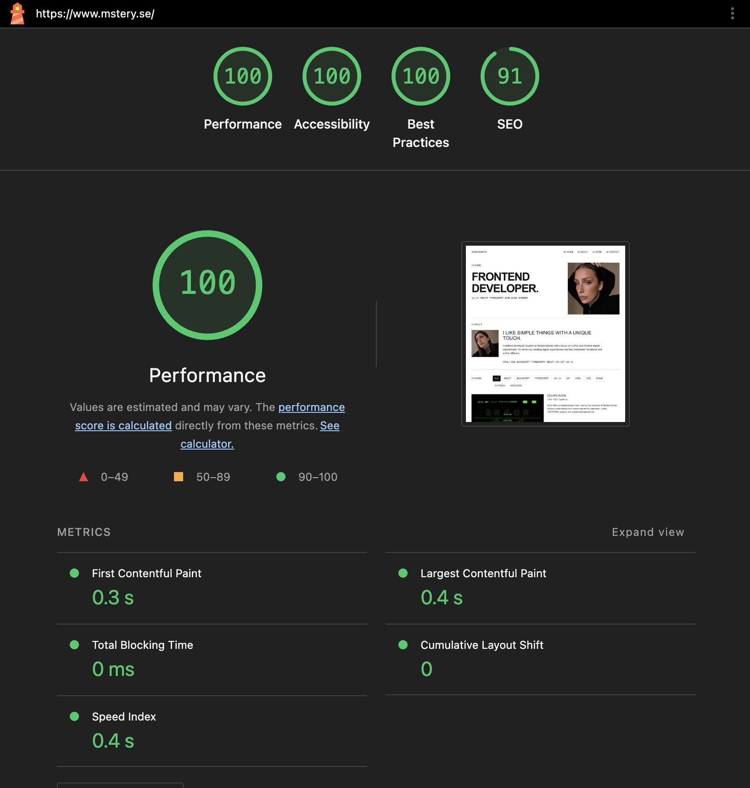
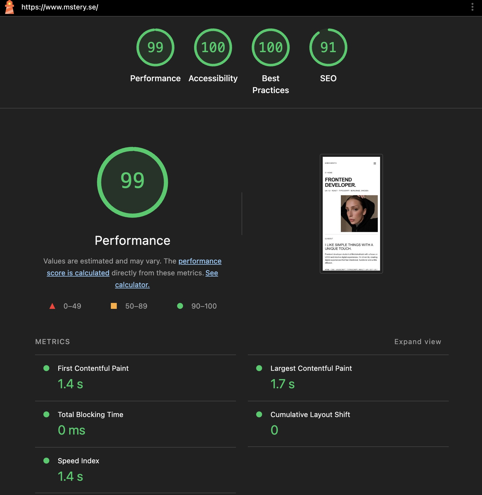

# Maria Birath – Portfolio

Min personliga portfolio, skapad som en skoluppgift på Medieinstitutet. Sidan presenterar mig, mina kunskaper och sex projekt från utbildningen. Den är byggd som en React single page application (SPA) med TypeScript och Vite.

## Länkar

- [Live – mstery.se](https://www.mstery.se)
- [Live – Vercel](https://portfolio-test11-d185.vercel.app)
- [Figma – mobil och desktop](https://www.figma.com/design/eSm3fNA8JJDPza2tc5RUVB/Portfolio)

## Teknik

- React och TypeScript
- Vite
- Vanlig CSS med grid, flexbox och media queries
- Motion för animationer
- ESLint för kodkontroll
- Figma för designskisser
- Git och GitHub för versionshantering
- Vercel för driftsättning

## Funktioner

- Sektionerna Home, About, Work och Contact med navigation via ankarlänkar.
- Sex projektkort med skärmbild, titel, beskrivning, teknik-taggar och länkar till GitHub och live-demo.
- Teknikfilter som visar en vald teknik åt gången. All visar alla projekt.
- Mobilmeny som kan öppnas och stängas. Den stängs även när en länk väljs eller Escape trycks.
- Kontaktlänkar till e-post, GitHub och LinkedIn.
- Responsiv layout för mobil, tablet och desktop.
- Projektkort som tonas in när de kommer in i bild. Animationen stängs av vid inställningen för minskad rörelse.

## Komponenter, props och state

App.tsx sätter ihop sidans delar. Komponenterna finns i src/components. Projects renderar projektkorten med .map() och skickar varje projekt som props till ProjectCard. Varje kort använder projektets stabila id som key.

Projektdatan finns separat i src/data/projects.ts och den gemensamma projekttypen finns i src/types.ts.

useState används för den valda teknik-taggen i Projects och för mobilmenyn i Header. Den filtrerade projektlistan räknas fram med .filter() vid varje rendering och sparas inte i ett eget state.

## Kör projektet lokalt

Du behöver Node.js och npm. Använd en Node.js-version som stöds av Vite 8, exempelvis Node.js 22.12 eller senare i 22-serien.

Klona repot och installera beroenden:

```bash
git clone https://github.com/mariabhai/Portfolio.git
cd Portfolio
npm ci
```

Starta utvecklingsservern:

```bash
npm run dev
```

Öppna adressen som visas i terminalen, vanligtvis http://localhost:5173.

## Bygg och kontrollera

```bash
npm run lint
npm run build
```

Build skapar produktionsversionen i dist. För att förhandsvisa den lokalt:

```bash
npm run preview
```

## Design och ändringar från Figma-skissen

Mobil- och desktopskisserna togs fram i Figma innan kodningen. Grundidén är en avskalad svartvit sida med stor typografi, tunna sektionslinjer och tydligt uppdelade sektioner.

Följande detaljer ändrades under arbetet:

- Grå bildplatshållare ersattes med porträtt och skärmbilder från projekten.
- Porträttet på startsidan fick en mindre, kvadratisk bildyta placerad till höger.
- Exempelprojekten ersattes med sex riktiga projekt och deras egna beskrivningar, tekniker och länkar.
- Mobilkorten fick beskrivningar och tydliga projektlänkar, som inte fanns med i mobilskissen.
- Teknikfiltren utökades efter projektens innehåll. Aktivt filter fick svart bakgrund och vit text, och avståndet till sektionsrubriken ökades.
- En diskret animation lades till på projektkorten.
- En footer med aktuellt år och en länk tillbaka till toppen lades till.

## Bildoptimering

Bilderna används i WebP-format med versioner i 400 och 800 pixlars bredd. srcSet och sizes hjälper webbläsaren att välja bildstorlek. Projektbilderna laddas med lazy loading. Porträttet på startsidan prioriteras med fetchPriority och preload i index.html.

## Driftsättning

Projektet är kopplat till Vercel via GitHub. Pushar till main startar en ny produktionsdeployment. Byggkommandot är npm run build och resultatmappen är dist. Den egna domänen mstery.se är kopplad till Vercel med DNS hos Loopia.

## Skärmbilder

### Desktop



### Mobil



## Lighthouse

Skärmbilderna nedan visar Lighthouse-mätningar av https://www.mstery.se.

| Kategori | Desktop | Mobil |
| --- | --- | --- |
| Performance | 100 | 99 |
| Accessibility | 100 | 100 |
| Best Practices | 100 | 100 |
| SEO | 91 | 91 |

### Desktoprapport



### Mobilrapport


